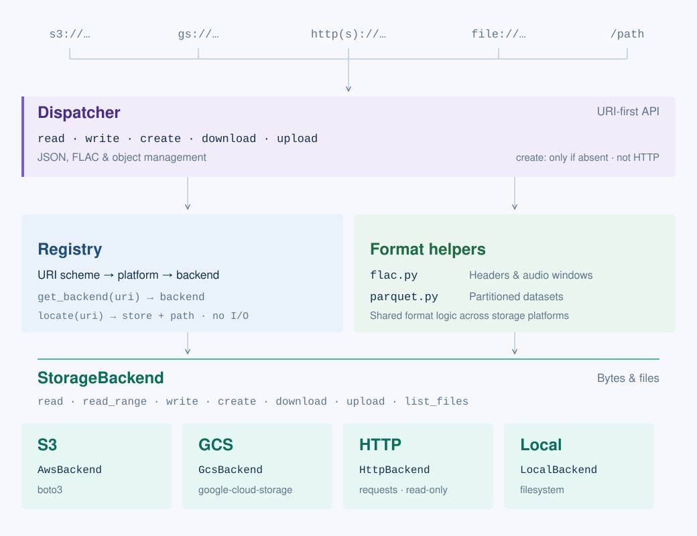

# ondio

`ondio` --- _ondas_ (Spanish for waves) + io --- is a Python package for uniform IO of
audio data (specifically just `.flac` at the moment) and results derived from
bioacoustic models (specifically `.json` and `.parquet` files) across a variety of
sources: AWS S3, GCS, HTTP/HTTPS, and local filesystems.

Every public function takes a URI; the platform is inferred from the URI scheme and
the call is dispatched to the matching backend, so the same code runs unchanged
against an S3 bucket, a GCS bucket, a web server, or a local directory.

`ondio` is a spin-off of [`soundhub_utils`](https://github.com/SchmidtDSE/soundhub_utils), with just the lightweight components to handle IO from generic backends.

## Naming: `read`/`write` vs `download`/`upload`

The API draws one distinction consistently:

- **`read` / `write`** move bytes **in and out of memory**. `read(uri)` returns
  `bytes`; `write(uri, data)` takes them. Nothing touches the local filesystem.
- **`download` / `upload`** move **files on disk**. `download(uri, out_path)`
  streams the object to a local path (creating parent directories);
  `upload(uri, source_path)` streams a local file to the URI without reading
  it into memory, replacing any existing object there. The URI always comes
  first, the local path second.

The format helpers follow the same rule: `read_flac` returns decoded samples or
FLAC bytes in memory, while `download_flac` writes a local `.flac` file;
`write_json` serializes a Python object straight to a URI, and `read_json`
fetches and parses one.

## Objects, files, and JSON

The same calls work with `s3://`, `gs://`, `http(s)://`, `file://`, or plain
local paths:

```python
import ondio

# moving objects into/from memory
data = ondio.read("s3://my-bucket/audio/rec.flac")        # -> bytes
ondio.write("s3://my-bucket/results/example.txt", b"done")

# JSON <-> Python objects, no local file involved
ondio.write_json("s3://my-bucket/results//summary.json", {"detections": 118})
summary = ondio.read_json("s3://my-bucket/results/summary.json")

# moving files on/off disk
ondio.download("gs://my-bucket/audio/rec.flac", "data/rec.flac")
ondio.upload("s3://my-bucket/audio/rec.flac", "data/rec.flac")

# create-only: refuses if an object exists; a reader never sees a partial object
ondio.create("s3://my-bucket/runs/1/result.json", b"{}")   # ObjectExistsError if present

# where a URI points: the store, and the path in it that ondio reads
ondio.locate("s3://my-bucket/runs/1/out")   # Location(store='s3://my-bucket', path='runs/1/out')

# many objects into one directory, named by basename; concurrent downloads,
# returned local paths follow the input order
local = ondio.download_files(uris, "results/", max_workers=8)

# listing and management — filename filters compose with max_items
uris = ondio.list_files("s3://my-bucket/results/")
flacs = ondio.list_files("s3://my-bucket/audio/", required_ext="flac")
chunks = ondio.list_files("s3://my-bucket/audio/", required_prefix="chunk_", max_items=100)
n_flacs = ondio.object_count("s3://my-bucket/audio/", required_ext="flac")
if ondio.exists("s3://my-bucket/tmp/scratch.json"):
    ondio.delete("s3://my-bucket/tmp/scratch.json")

# keyword arguments are forwarded to the backend constructor
# (for s3:// that's boto3.Session — e.g. picking an AWS profile)
ondio.list_files("s3://my-bucket/audio/", profile_name="dse")
```

`create` works on S3 (a conditional `PUT` with `If-None-Match: *`), on GCS (a
conditional upload with `if_generation_match=0`), and on local disk (a temporary file
linked into place). HTTP raises `UnsupportedOperationError`, before loading optional
SDKs or initializing credentials. S3 and GCS transport failures raise `OndioError`,
with the original exception as the cause. If `create` fails for any reason other than
`ObjectExistsError`, the object may or may not exist; read it to find out. On S3 and
GCS, `ObjectExistsError` can name an object that the same call wrote, when the client
retried after a lost response; compare the bytes if you need to know who wrote it.

Listing prefixes have folder semantics on every backend: a path names the
object at that exact location plus everything under it as a folder, never
sibling objects that merely share leading characters —
`s3://my-bucket/results/run-1` matches `results/run-1/…` but **not**
`results/run-10/…`. To match objects by partial *filename* (e.g. everything
starting with `chunk_`), use `required_prefix` as above.

A **trailing slash narrows the path to folder contents only**, excluding an
object stored at the path itself. This matters only where both exist:

```python
ondio.list_files("s3://my-bucket/results/run-1")   # the run-1 object, if any, plus run-1/…
ondio.list_files("s3://my-bucket/results/run-1/")  # only run-1/… — never the run-1 object
```

`object_count(prefix)` always equals `len(list_files(prefix))` given the same
filters, on every backend — folder placeholder objects (the empty `dir/` keys
some consoles create) are counted by neither.

### Endpoints

`endpoint_url=` sets the S3 or GCS endpoint, for example an S3 store that is not
AWS. To make another process (a worker, a batch job) use the same endpoint,
`get_environment` gives the environment variables to set there; that process then
calls ondio with no options:

```python
ondio.read("s3://my-bucket/runs/1/out", endpoint_url="http://127.0.0.1:9000")
env = ondio.get_environment("s3://my-bucket/runs/1", endpoint_url="http://127.0.0.1:9000")
# {"AWS_ENDPOINT_URL_S3": "http://127.0.0.1:9000"}: add it to the worker's environment
```

An option that no variable carries (`profile_name`, `region_name`, or `endpoint_url`
on GCS) raises `UnsupportedOperationError`, rather than being dropped. The other
process must not set `AWS_IGNORE_CONFIGURED_ENDPOINT_URLS`, which makes S3 ignore the
endpoint variable.

## FLAC

FLAC-specific IO lives behind the same read/download split. Decoding uses
soundfile, whose wheels bundle libsndfile, so nothing needs to be on PATH.
A time window `[start_sec, end_sec)` is cut by sample index:
`[round(start_sec * sr), round(end_sec * sr))`.

```python
import ondio

# parse STREAMINFO fetching only header bytes — never the audio
header = ondio.extract_flac_header("s3://my-bucket/audio/rec.flac")
header.sample_rate, header.channels, header.duration

# in memory: decode a 3 s window to PCM — a float32 array of shape
# (frames, channels) in [-1, 1] plus the sample rate, like libsndfile
samples, rate = ondio.read_flac("s3://my-bucket/audio/rec.flac", 60.0, 63.0)

# in memory: the same window as bytes of a standalone .flac (lossless re-encode)
clip = ondio.read_flac("s3://my-bucket/audio/rec.flac", 60.0, 63.0, decode=False)

# in memory: whole file with decode=False is the original bytes exactly, no decoding
raw = ondio.read_flac("s3://my-bucket/audio/rec.flac", decode=False)

# on disk: cut a clip straight to a local .flac file
ondio.download_flac("s3://my-bucket/audio/rec.flac", "clips/rec_60-63.flac", 60.0, 63.0)

# on disk: no window means a plain byte-for-byte download
ondio.download_flac("s3://my-bucket/audio/rec.flac", "data/rec.flac")
```

### Windowed reads of remote files

Windowed reads of large remote files fetch only a byte range around the window
instead of the whole object. The ranged path is chosen automatically for files
over 50 MB when the window is under a third of the stream duration;
`use_range=True`/`False` forces either path. A ranged read that succeeds returns
exactly the samples a full download would.

`ondio` estimates the byte range from the file's seek table. If the file has
no seek table, it uses the average bitrate. The estimate only chooses what to
fetch. In the fetched bytes, `ondio` finds a run of real FLAC frames:
CRC-checked headers whose sample numbers continue one another. The frames give
the true first sample, and the window is cut by sample index. If the run does
not cover the window, the fetch is widened. Widening fetches only new bytes,
so a ranged read never fetches more than the file, in a few requests. When the
estimate is far off (no seek table and very uneven bitrate), a ranged read can
fetch a large part of the file.

Damaged input raises an error on both paths. A window that reaches into a corrupt
or truncated region raises `OndioError`. A file whose header overstates its
length (truncated recorder files exist) raises for windows past its real end.
Windows clear of the damage read exactly. If the damage is in the bytes already
fetched, the ranged read raises without widening the fetch. A ranged failure names
`use_range=False`: a full download is never started on your behalf.
`padding_ratio` is deprecated and ignored.

## Parquet

Model results go out as hive-partitioned parquet datasets via
`ondio.parquet.write_parquet` (requires the `parquet` extra for pyarrow). The
dataset is written to a local temp directory with pyarrow, then uploaded
file-by-file through the backend — pyarrow's native S3/GCS filesystems are
deliberately not used (this would require extra credential config), so credentials 
follow the same path as every other `ondio` call.

```python
import pyarrow as pa
from ondio.parquet import write_parquet

table = pa.table({
    "site": ["A", "A", "B"],
    "date": ["2026-04-02", "2026-04-02", "2026-04-03"],
    "species": ["GRSP", "WEME", "GRSP"],
    "confidence": [0.91, 0.87, 0.66],
})

# writes s3://my-bucket/results/run-1/site=A/date=2026-04-02/part-0.parquet, ...
write_parquet("s3://my-bucket/results/run-1", table, partition_cols=["site", "date"])

# partition_cols=[] writes a flat (unpartitioned) dataset under the prefix
write_parquet("s3://my-bucket/results/run-2/", table, partition_cols=[])
```

Details of use:

- **`overwrite`** — by default (`overwrite=False`) the call refuses with
  `OndioError` if any objects already exist under the prefix, so two runs can
  never silently merge into one dataset. `overwrite=True` deletes everything
  under the prefix first, then writes.
- **`compression`** — parquet codec, default `"snappy"`.
- **`max_workers`** — the per-file uploads run in a thread pool; this caps its
  size (default lets the executor decide).
- Backend constructor kwargs pass through as everywhere else
  (e.g. `profile_name="fieldwork"` for S3).

There is no `download_parquet`: readers should point their query engine
(pyarrow, DuckDB, polars) at the dataset directly, or fetch individual files
with `ondio.download` / `ondio.list_files`.

## Known differences from soundhub_utils

`ondio` is not a drop-in port; the differences below are deliberate. The FLAC
ones were established empirically by running both implementations side by side
on synthetic fixtures and on real field recordings.

### API shape

- One URI-first dispatcher replaces the per-platform modules (`io.aws`,
  `io.gcs`, `io.url`): the URI scheme picks the backend, and platform SDKs and
  their types never leak through the public API.
- The `read`/`write` (memory) vs `download`/`upload` (disk) naming rule is
  applied consistently. Legacy's `io.read_flac(src, dest, ...)` actually wrote
  a file to disk; its counterpart here is `download_flac(uri, out_path, ...)`.
- Failures raise typed exceptions (`OndioError`, `ObjectNotFoundError`,
  `AuthError`, ...) instead of only being logged: logging (via cocina's
  `Printer`, as in soundhub_utils) narrates progress and decisions, but is
  never the sole signal that something went wrong.
- `download_files` raises `ValueError` upfront when two URIs share a basename
  (they would overwrite each other in the destination directory); legacy
  silently clobbered. It also downloads concurrently and dispatches each URI
  independently, so schemes may be mixed in one call.
- There is no per-call `printer=` argument (call kwargs are reserved for
  backend configuration). Narration goes to cocina's process-wide `Printer`
  singleton when cocina is installed, and is a silent no-op otherwise. To
  route it to your own printer-like object instead (anything with
  `.message`, `.error`, ...), call `ondio.set_printer(obj)` once at startup;
  `ondio.set_printer(None)` restores the default.

### Ranged (windowed) FLAC reads

- **Ranged windows are sample-exact.** Legacy (and `ondio` before 0.3.0)
  estimated byte offsets linearly from the header's duration and assumed the
  decoded audio began at the estimated time. FLAC's bitrate varies with the
  content, so on real multi-hour recordings windows came back from the wrong
  time — by a median of about 30 s — with no error. `ondio` now locates the
  window from the frame numbers in the fetched bytes.
- **Damaged input raises an error.** A window that can't be located or decoded raises
  `OndioError` naming `use_range=False`; there is no silent short result and
  no implicit full download. Legacy's only length check was a log message with
  a 1-second tolerance: it silently returned short audio, and on files whose
  header overstates the duration it returned fabricated audio for windows past
  the real end of the stream.
- **Ranged fetches are optional and bounded.** Legacy always byte-ranged
  partial requests, with no full-file fallback. `ondio` ranges automatically
  only for files over 50 MB with windows under a third of the duration. A
  ranged read fetches each byte at most once, so never more than the file, and
  `use_range=False` always forces the full-download path.
- **Windows are cut by sample, not millisecond.** Legacy sliced at integer
  milliseconds (truncating, so float artifacts like `1.4 - 0.4 == 0.9999…`
  cost it a further millisecond); `ondio` cuts `[round(start_sec * sr),
  round(end_sec * sr))` on every path.
- **No ffmpeg.** Decoding and encoding use soundfile, whose wheels bundle
  libsndfile. A whole-file decode of a truncated or unknown-length stream now
  raises `OndioError`; ffmpeg used to return the decodable part. A windowed
  re-encode (`decode=False` or `download_flac`) of a 12- or 20-bit source
  raises `OndioError`, because libsndfile writes only 8, 16 and 24 bits;
  `decode=True` still reads it.

### FLAC header parsing

- Legacy's `extract_header` mis-parses the STREAMINFO bit fields: stereo files
  report 1 channel, and 16- and 24-bit files both report 17 bits per sample.
  `ondio.extract_flac_header` parses the block per the FLAC spec (verified
  against libsndfile) and fetches only header bytes, skipping metadata block
  bodies such as embedded artwork instead of downloading them.

## Architecture

`ondio` defines a unified interface for reading/writing files across different platforms, where the target platform is inferred based on the structure of the URI. The URI structure is used to dispatch to platform specific implementations, combining the [strategy](https://en.wikipedia.org/wiki/Strategy_pattern) and [registry](https://martinfowler.com/eaaCatalog/registry.html) design patterns.

### Layers

`ondio` follows a layered structure. The primary layer users interact with is the
public API: generic read/write methods plus format-specific ones.

The second layer is the registry, which maps URI schemes to approriate backends, and
specific helpers for `.flac` and `.parquet` files. File-format specific logic only lives at
this layer --- the backends only operate on bytes and arbitrary files on disk, and never
implement format-specific logic.


| Function | Description |
|-|-|
| `read(uri)` | Read the full object at `uri` into memory as `bytes` |
| `write(uri, data)` | Write in-memory `bytes` to `uri` |
| `write_json(uri, obj)` / `read_json(uri)` | JSON objects, serialized/parsed |
| `download(uri, out_path)` | Download the object at `uri` to a local file |
| `download_files(uris, local_dir)` | Download many objects into a directory, named by basename; returns local paths in input order |
| `upload(uri, source_path)` | Stream a local file to `uri`, replacing any existing object |
| `extract_flac_header(uri)` | Parse FLAC STREAMINFO, fetching only header bytes |
| `read_flac(uri, start_sec, end_sec, decode=…)` | FLAC (whole or windowed) → PCM array or FLAC bytes |
| `download_flac(uri, out_path, start_sec, end_sec)` | FLAC (whole or windowed) → local `.flac` file |
| `write_parquet(uri, table, partition_cols)` | `pyarrow.Table` → hive-partitioned dataset (in `ondio.parquet`) |
| `list_files(uri_prefix)` | Full URIs under a folder path (exact object plus its contents), sorted; optional filename prefix/extension filters |
| `object_count(uri_prefix)` | Count objects under a folder path without listing them; same filters |
| `exists(uri)` | Whether the object exists |
| `delete(uri)` | Delete the object; missing objects are a no-op |

Each call resolves a backend from the URI scheme and delegates to it:



- **dispatcher** — what callers import: every function takes a URI, infers the platform, and delegates. No platform types leak out.
- **registry** — the strategy lookup: maps the URI scheme to a platform name and lazily constructs that platform's backend.
- **format helpers** — FLAC and Parquet logic written once against the backend protocol, so partial FLAC reads work identically on S3, GCS, HTTP, and local files. FLAC decoding and encoding use soundfile (libsndfile, bundled in its wheel).
- **backends** — one class per platform implementing the byte-level protocol (`read_range` is what makes partial reads cheap on remote files); each wraps its platform SDK and translates its errors to ondio's exception types.
